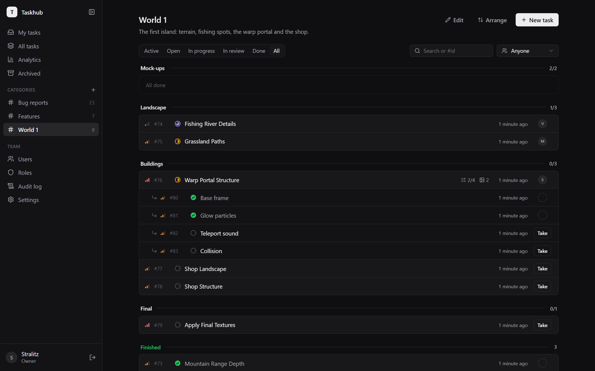
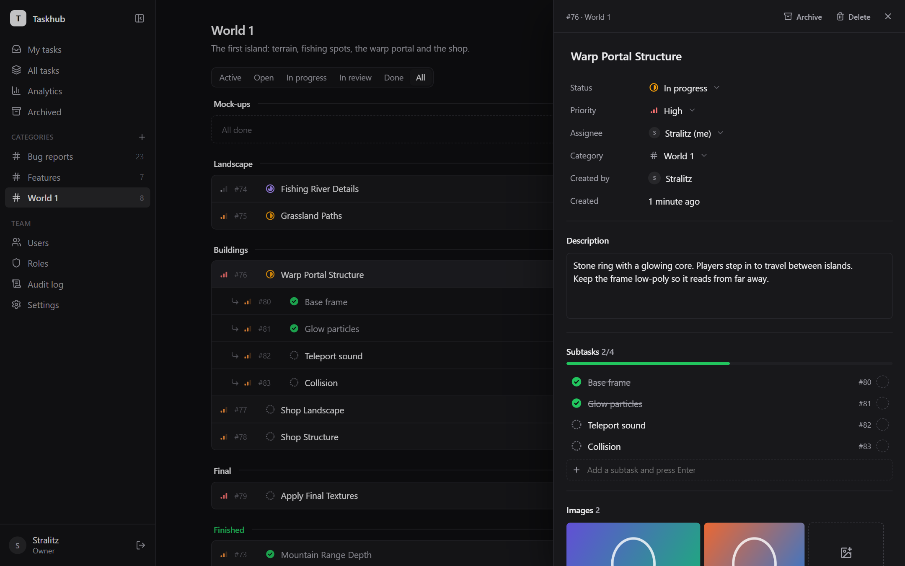
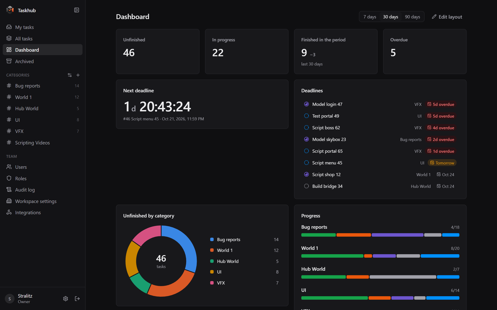
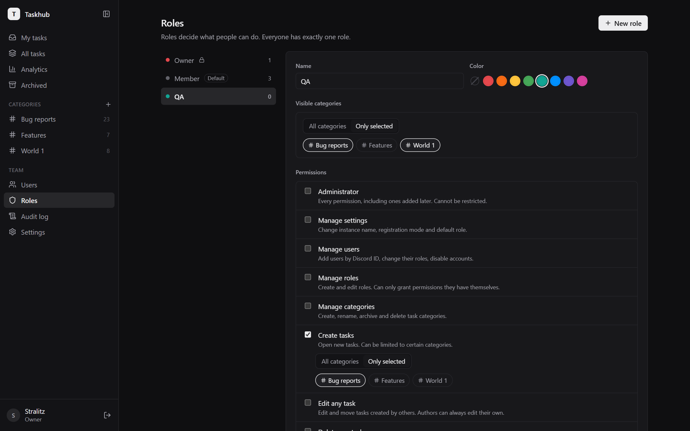
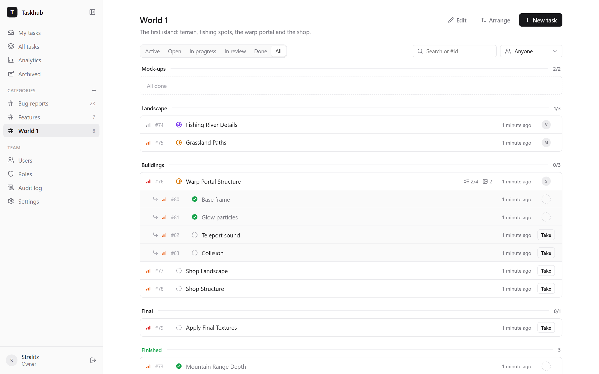

<p align="center"></p>

# Taskhub

A small self-hosted task tracker for dev teams. People sign in with Discord, work is split into categories and stages, and every change ends up in an audit log.



## Features

**Tasks**
- **Categories and stages.** Group tasks into categories like "Bug reports" or "World 1", and split a category into stages with sections. The order is yours: switch to **Arrange** and drag rows by the handle.
- **Statuses, priorities, people.** Open → In progress → In review → Done, low / medium / high priority, one assignee. Anyone allowed can take an unassigned task, leads can assign to anyone.
- **Subtasks.** Break a task into steps with their own status and assignee; the parent shows progress. Subtasks move, archive and get deleted together with their parent.
- **Finished at the bottom.** Inside a category, done work collects in a "Finished" section, while each stage keeps counting it.
- **Images.** Paste a screenshot with Ctrl+V, drop files or pick them. Shown as a tidy grid with a full-screen viewer.
- **Archive.** Take old or irrelevant tasks out of lists and the dashboard without losing them; restore any time.

**Team**
- **Discord sign-in.** No passwords. The first person to sign in becomes the owner; everyone else is added by Discord user ID, or you can open registration to anyone.
- **Roles and permissions.** Any mix of: manage settings, users, roles and categories; create, edit, delete any or delete own tasks; assign and take tasks; view the audit log.
- **Per-role category limits.** Decide which categories a role can see at all, and in which it can create tasks. Hidden categories disappear everywhere, including direct links, the dashboard and the audit log.
- **No privilege escalation.** People can only grant permissions and categories they have themselves, and cannot change their own role.

**Overview**
- **Dashboard.** One shared dashboard built from widgets: counts, countdowns and deadlines, breakdowns as rings or bars, progress per category and section, created vs finished over time, a honeycomb of categories, an activity calendar, stuck tasks, workload and notes. People with the right permission arrange it.
- **Audit log.** Every change to tasks, categories, users, roles and settings, with who did it and what changed. Each task also shows its own history.
- **API and AI agents.** Personal API tokens and a built-in MCP server, so Claude Code and other agents can find, create, take and update tasks with exactly their owner's permissions. Their changes are marked in the history. See [docs/API.md](docs/API.md).
- **Discord webhooks.** Post a feed of chosen events (new tasks, status changes, finished work, and more) to any Discord channel, limited to the categories you pick. Bursts are combined into one message and Discord rate limits are respected.

**Small and easy to run**
- One Node.js process with SQLite built into Node: no native modules, no external database, one port. Runs fine on the smallest VPS.
- Your own name and logo, a collapsible sidebar, and it works on phones.
- **Themes.** Light, dark, a few built-in ones, and your own colors. People with the right permission can add workspace themes for everyone, including custom CSS for effects (see [docs/themes/hyperpink.css](docs/themes/hyperpink.css) for an over-the-top example).

| Task details | Dashboard |
|---|---|
|  |  |
| **Roles with category limits** | **Light theme** |
|  |  |

## Quick start with Docker

1. Create a Discord application at <https://discord.com/developers/applications>. Under **OAuth2**, copy the Client ID and Client Secret and add a redirect: `https://your-domain.example/api/auth/callback`.
2. Configure and start:

   ```sh
   git clone https://github.com/excedereo/taskhub.git
   cd taskhub
   cp .env.example .env   # fill in DISCORD_CLIENT_ID, DISCORD_CLIENT_SECRET, PUBLIC_URL
   docker compose up -d --build
   ```

3. Open your `PUBLIC_URL` and sign in. You are the owner now. Add teammates on the **Users** page by their Discord user ID (Discord → Settings → Advanced → Developer Mode, then right-click a person → Copy User ID).

Everything lives in the `taskhub-data` Docker volume: the database `taskhub.db` and uploaded images in `uploads/`. Back up the whole `/data` folder.

The container only listens on `127.0.0.1:3000`, so put a reverse proxy with HTTPS in front of it. With Caddy the whole config is:

```
taskhub.example.com {
	reverse_proxy 127.0.0.1:3000
}
```

When `PUBLIC_URL` starts with `https://`, cookies are marked secure automatically.

## Running without Docker

Requires Node.js 22.18 or newer (24 recommended).

```sh
npm install
npm run build
cp .env.example .env   # fill it in
npm start
```

The server serves the built frontend and the API on `PORT` (3000 by default).

## Development

```sh
npm install
cp .env.example .env
```

In `.env` set `PUBLIC_URL=http://localhost:5173` and either fill in Discord credentials (with redirect `http://localhost:5173/api/auth/callback`) or set `DEV_LOGIN=true` to get a "sign in without Discord" form. Then:

```sh
npm run dev        # API on :3000, Vite on :5173 with hot reload
npm run typecheck
```

The server is TypeScript run directly by Node (type stripping), so there is no build step for it. Database migrations live in `server/src/db.ts` and run on startup.

### Project layout

```
server/src/
  index.ts         app setup, static files, error handling
  db.ts            SQLite connection and migrations
  auth.ts          sessions and sign-in rules
  permissions.ts   the permission list and category limits
  http.ts          request helpers, permission and visibility checks
  audit.ts         audit log helpers
  routes/          auth, users, roles, categories, tasks, attachments, dashboard,
                   themes, tokens, mcp, integrations, logo, audit + settings
  integrations.ts  Discord webhook queue and delivery
web/src/
  pages/           one file per screen
  dashboard/       dashboard widgets and their settings
  tour/            the guided tour, one guide per feature
  components/      sidebar, task panel, category list, gallery, select, shared UI
  styles.css       all styles; design tokens at the top
```

## Configuration

| Variable | Default | |
|---|---|---|
| `DISCORD_CLIENT_ID` | | Discord application client ID |
| `DISCORD_CLIENT_SECRET` | | Discord application client secret |
| `PUBLIC_URL` | `http://localhost:3000` | Address people open, used for the OAuth redirect |
| `PORT` | `3000` | Port to listen on |
| `DATABASE_PATH` | `data/taskhub.db` | SQLite file location; uploads are stored next to it |
| `SESSION_DAYS` | `30` | How long a sign-in lasts |
| `DEV_LOGIN` | `false` | Sign in without Discord. Ignored in production |
| `MAX_UPLOAD_MB` | `10` | Largest image that can be attached to a task |
| `REPO_URL` | `https://github.com/excedereo/taskhub` | Where the "Source code" link in the profile points. Set it to your fork if you change the code |
| `GIT_COMMIT` | | Commit shown next to the version; `GIT_COMMIT=$(git rev-parse --short HEAD) docker compose up -d --build` fills it in |

The instance name, logo, registration mode and default role are set in the app under **Settings**.

## License

Taskhub is free software under the [GNU Affero General Public License v3.0](LICENSE). You can use, change and share it. If you run a modified version for other people over a network, you have to offer them its source code: the profile page links to it, so point `REPO_URL` at your fork.

Copyright (C) 2026 Taskhub contributors. Versions published before 20 October 2026 were released under the MIT license.
