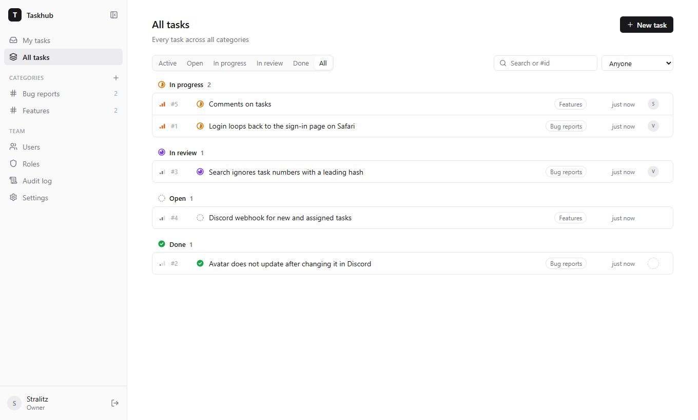
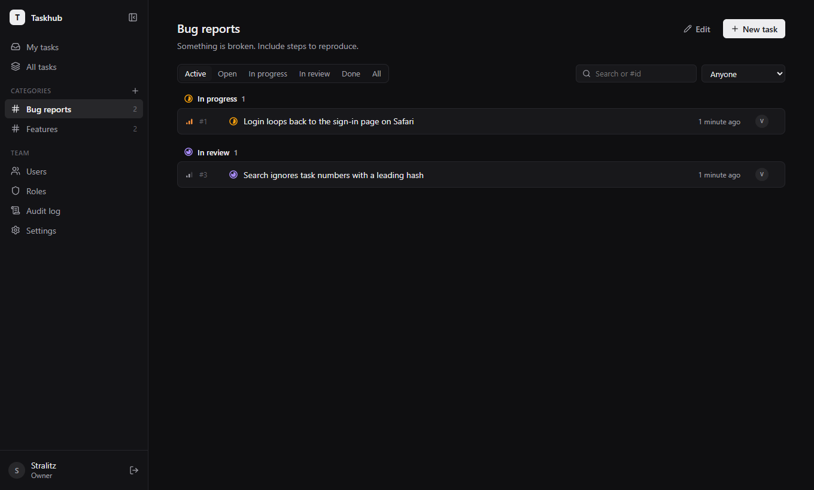

# Taskhub

A small self-hosted task tracker for dev teams. People sign in with Discord, tasks live in categories like "Bug reports" or "Features", and every change ends up in an audit log.



## Features

- **Discord sign-in.** No passwords. The first person to sign in becomes the owner; everyone else is added by Discord user ID (or you can open registration to anyone).
- **Roles and permissions.** Create roles with any mix of permissions: manage users, manage roles, manage categories, create, edit, delete, assign and take tasks, view the audit log, manage settings. People can only grant permissions they have themselves.
- **Categories and tasks.** Tasks have a status (Open → In progress → In review → Done), a priority and an assignee. Anyone allowed can take an unassigned task, leads can assign to anyone.
- **Audit log.** Every change to tasks, categories, users, roles and settings is recorded with who did it and what changed. Each task shows its own history.
- **Single process, single file database.** Node.js + SQLite (built into Node, no native modules), served behind one port. Runs fine on the smallest VPS.
- Light and dark themes, collapsible sidebar, works on phones.

| Task details | Roles | Dark theme |
|---|---|---|
|  |  |  |

## Quick start with Docker

1. Create a Discord application at <https://discord.com/developers/applications>. Under **OAuth2**, copy the Client ID and Client Secret and add a redirect: `https://your-domain.example/api/auth/callback`.
2. Configure and start:

   ```sh
   git clone https://github.com/excedereo/taskhub.git
   cd taskhub
   cp .env.example .env   # fill in DISCORD_CLIENT_ID, DISCORD_CLIENT_SECRET, PUBLIC_URL
   docker compose up -d --build
   ```

3. Open your `PUBLIC_URL` and sign in. You are the owner now. Add teammates on the **Users** page by their Discord user ID (Discord → Settings → Advanced → Developer Mode, then right-click a person → Copy User ID).

Data is stored in the `taskhub-data` Docker volume. Back it up by copying `/data/taskhub.db` out of the container.

The container only listens on `127.0.0.1:3000`, so put a reverse proxy with HTTPS in front of it. With Caddy the whole config is:

```
taskhub.example.com {
	reverse_proxy 127.0.0.1:3000
}
```

When `PUBLIC_URL` starts with `https://`, cookies are marked secure automatically.

## Running without Docker

Requires Node.js 22.18 or newer (24 recommended).

```sh
npm install
npm run build
cp .env.example .env   # fill it in
npm start
```

The server serves the built frontend and the API on `PORT` (3000 by default).

## Development

```sh
npm install
cp .env.example .env
```

In `.env` set `PUBLIC_URL=http://localhost:5173` and either fill in Discord credentials (with redirect `http://localhost:5173/api/auth/callback`) or set `DEV_LOGIN=true` to get a "sign in without Discord" form. Then:

```sh
npm run dev        # API on :3000, Vite on :5173 with hot reload
npm run typecheck
```

The server is TypeScript run directly by Node (type stripping), so there is no build step for it. Database migrations live in `server/src/db.ts` and run on startup.

### Project layout

```
server/src/
  index.ts         app setup, static files, error handling
  db.ts            SQLite connection and migrations
  auth.ts          sessions and sign-in rules
  permissions.ts   the permission list
  audit.ts         audit log helpers
  routes/          auth, users, roles, categories, tasks, audit + settings
web/src/
  pages/           one file per screen
  components/      sidebar, task panel, modals, shared UI
  styles.css       all styles; design tokens at the top
```

## Configuration

| Variable | Default | |
|---|---|---|
| `DISCORD_CLIENT_ID` | | Discord application client ID |
| `DISCORD_CLIENT_SECRET` | | Discord application client secret |
| `PUBLIC_URL` | `http://localhost:3000` | Address people open, used for the OAuth redirect |
| `PORT` | `3000` | Port to listen on |
| `DATABASE_PATH` | `data/taskhub.db` | SQLite file location |
| `SESSION_DAYS` | `30` | How long a sign-in lasts |
| `DEV_LOGIN` | `false` | Sign in without Discord. Ignored in production |

## License

[MIT](LICENSE)
